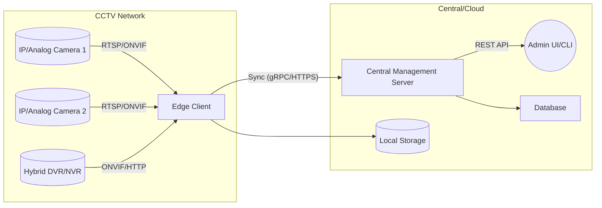
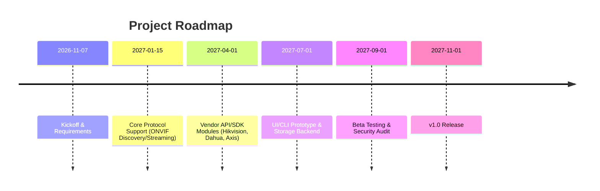

# Executive Summary  
Managing diverse CCTV systems across multiple vendors requires supporting standard protocols and vendor-specific interfaces. A unified tool must cover ONVIF (for device discovery, configuration and streaming) and direct streaming protocols like RTSP/RTMP, plus proprietary HTTP/SDK interfaces. For example, **ONVIF** provides SOAP-based APIs for camera setup and discovery, handling many core features (network config, PTZ, events, recording). Axis’s open *VAPIX* API similarly offers HTTP endpoints for Axis cameras. Vendors like Hikvision and Dahua add their own APIs/SDKs for advanced functions: Hikvision’s HCNetSDK (Device Network SDK) covers login, streaming, PTZ, playback and alarm/event management, with a generic `GetConfig/SetConfig` XML interface for other settings. Dahua provides an HTTP CGI API (e.g. `/cgi-bin/configManager.cgi?action=getConfig&name=VideoColor`) and a Java/C SDK for deeper integration. 

A multi-tier architecture is recommended: a **lightweight edge client** handles local discovery, streaming ingestion, and minimal processing, while a **central server** aggregates data (for multi-site oversight). A **hybrid** model uses edge devices for on-site capture/analytics and a cloud/server for centralized management. Key design considerations include supporting ONVIF/RTSP for interoperability, integrating vendor SDKs for proprietary features, and ensuring secure communications (e.g. ONVIF’s TLS add-on, HTTPS). Based on primary sources and open projects (e.g. Shinobi’s use of ONVIF/RTSP, ZoneMinder’s REST API), we outline detailed protocol comparisons, architecture options, tech choices (languages, databases, frameworks), a development roadmap, risk/security checklist, and example REST API endpoints.  

# Protocols, Codecs and Standards  
We must support: 

- **ONVIF** (SOAP/WS-Discovery). A de-facto standard for IP cameras; ONVIF’s profiles (S/T for streaming, G for recording, etc.) define interfaces for system/network settings, device discovery, streaming control, PTZ, and event/recording management. ONVIF discovery (WS-Discovery) uses multicast probing. ONVIF clients configure devices and obtain RTSP URIs for streams. Encryption via TLS is optional (ONVIF TLS add-on exists), and digest authentication is typical. ONVIF devices often offer SRTP for encrypted streams. 

- **RTSP (Real-Time Streaming Protocol)**. Used for live video streaming; cameras typically expose an RTSP URI (e.g. `rtsp://user:pass@ip:554/…`). RTSP provides low-latency, high-quality streams. It is widely supported (ONVIF often returns RTSP URLs). RTSP itself has no built-in security (but can run over TLS as RTSP over HTTPS or use SRTP). 

- **RTMP (Real-Time Messaging Protocol)**. Used for streaming to servers (e.g. Wowza, CDN); some cameras can push RTMP, but it’s less common now. 

- **HTTP APIs (CGI/REST)**. Many vendors expose camera config/status via HTTP GET/POST. For example, Dahua’s HTTP CGI API (e.g. `/cgi-bin/configManager.cgi?action=getConfig&name=VideoColor`) allows reading/writing camera settings. Hikvision’s ISAPI endpoints (e.g. `/ISAPI/System/deviceInfo`) serve similar purposes. Axis’s VAPIX is an HTTP/HTTPS API with XML/JSON for almost all camera functions. These APIs use basic or digest HTTP auth; HTTPS may be available. 

- **Proprietary Protocols**. Older analog PTZ cameras use serial protocols (e.g. Pelco-D/P) via RS-485 on DVRs. We’d handle these indirectly via the DVR/NVR’s network API.  

- **Audio/Video Codecs**. Common video: H.264, H.265, MJPEG; audio: G.711, AAC, PCM. The tool should negotiate or transcode these as needed (using ffmpeg/GStreamer). Codec licensing (especially H.264/H.265) must be respected if transcoding/encoding. 

- **Discovery Methods**. ONVIF WS-Discovery (UDP multicast) and UPnP/SSDP (multicast 239.255.255.250:1900) are primary. SSDP is “enabled by default on IoT devices” for service announcement. Additional techniques: ARP/network scanning, SNMP queries (some cameras), and DHCP lease info. 

- **Authentication & Encryption**. Devices use HTTP Basic/Digest (ONVIF typically digest), HTTPS (TLS1.2+) is preferred for APIs. Many cameras support HTTPS on port 443. ONVIF supports a TLS add-on for encrypted SOAP. For streams, SRTP or RTSP over TLS should be used if available. 

- **Firmware Update Mechanisms**. Typically via device’s web UI or proprietary tools. Some devices allow firmware upload through HTTP/SOAP (e.g. ONVIF Profile G may support firmware). These updates must be signed/verified to avoid malicious firmware. 

- **Legal/License Issues**. ONVIF is open, but conformance claims are regulated (only for members). Using ONVIF and standard protocols is free, but some features may be patented (ONVIF has patents declared). Codecs: H.264/H.265 involve patent pools (outside scope if only streaming). Vendor SDKs often have NDA or redistribution limits; e.g. Hikvision’s HCNetSDK is under Hikvision’s terms, Dahua’s NetSDK likewise. Respect open-source licenses (e.g. GNU GPL if using libraries).  

## Comparative Protocols Table  

| Protocol/Interface | Purpose                      | Standard?         | Encryption/Auth            | Notes/Examples                                                  |
|--------------------|------------------------------|-------------------|----------------------------|-----------------------------------------------------------------|
| ONVIF (SOAP)       | Device discovery/config, stream control (Profile S/G/T) | Open industry standard | Optional TLS (add-on), Digest auth | Cross-vendor; returns RTSP URLs; multi-profile (S=stream, G=recording, etc.). Widely supported on IP cameras. |
| RTSP (RFC 2326)    | Streaming protocol (live video) | IETF standard   | RTSPS (TLS) or SRTP optional; no built-in auth | Low-latency video transport. Common URI format (`rtsp://user:pass@ip:port/`). Must handle TCP/UDP (Dahua supports both). |
| RTMP               | Streaming protocol (push to server) | Proprietary (Adobe) | Usually TLS (RTMPS) supported | Used to send camera streams to media servers/CDNs. Less common now. |
| HTTP API / CGI     | Device config/status          | Vendor-specific  | HTTPS with Basic/Digest  | E.g. Axis VAPIX (open API), Dahua CGI (getConfig/setConfig), Hikvision ISAPI endpoints. Supports granular settings (video, network, motion). |
| Proprietary Vendor | Low-level control (PTZ on analog), access control | Proprietary | Varies (some use H.264-encoded channels) | E.g. serial protocols (Pelco-D/P) via DVR. Encoders/DVRs often expose these functions via their network APIs or ONVIF. |
| SSDP (UPnP)        | Device discovery              | Open standard   | None                       | IoT discovery (UDP 1900). Some cameras respond to SSDP UPnP queries. |
| SNMP               | Status monitoring (rare)      | Open           | SNMPv3 (auth+enc)          | Some cameras/NVRs offer SNMP for health/alerts.                   |


# Vendor APIs and SDKs  

| Vendor    | ONVIF | Streaming (RTSP/RTMP) | API/SDK                                   | Languages/SW                |
|-----------|:-----:|:----------------------:|-------------------------------------------|-----------------------------|
| **Axis**  | Yes (Profiles S/T) | Yes                 | **VAPIX® (HTTP/HTTPS)** – open API using standard protocols. Extensive endpoints for configuration and streaming. No separate SDK needed (uses HTTP/XML/JSON). | Any (via HTTP); official examples in C, Java. |
| **Hikvision** | Yes (S/T/G profiles) | Yes                 | **ISAPI/CGI** – HTTP endpoints (e.g. `/ISAPI/System/network/interfaces`) and **HCNetSDK (Device Network SDK)** – native DLLs for C/C#/Java.  GO wrapper exists. HCNetSDK covers login, live view, PTZ, playback, events, LPR, plus generic `GetConfig`/`SetConfig` for other settings. | C/C++/C#/Java (HCNetSDK); REST (ISAPI) with any language. |
| **Dahua** | Yes   | Yes                 | **HTTP CGI API** – old cameras (V2) and new (V3) CGI endpoints (`magicBox.cgi`, `configManager.cgi`) for streaming and config. **Dahua NetSDK** – provided for NVR/DVR integration (C/C#, Linux/Windows). | C/C++/C#, Java, Python wrappers available (e.g. [40]). |
| **Uniview** | Yes  | Yes                 | HTTP API (similar to Dahua CGI). Uniview also offers an **SDK** (SDK Manager, IPC SDK in C#) and **EZVIZ/WeDeploy** cloud API for devices. | C/C++, .NET (official SDK); HTTP/REST. |
| **Hanwha (Samsung Wisenet)** | Yes | Yes | **Wisenet Open Platform SDK** – offers real-time streaming, control, analytics, recording, device setup. Also **WAVE VMS Server API** (REST). SDK supports YUV, H.264/H.265, G.711 audio. Provides built-in analytics (motion, face, tamper, etc.). | C/C++ (SDK); RESTful HTTP (WAVE API). |
| **Bosch** | Yes | Yes | HTTP/HTTPS API (based on ONVIF/GenICam). *Not detailed here*, but Bosch devices also support ONVIF and have their own extensions (e.g. BVMS API). | C/C++, .NET, Java (Bosch VMS SDK). |
| **Analog (DVR/NVR)** | N/A (via device) | Streams via NVR (RTSP or proprietary) | NVR’s ONVIF interface or vendor SDK. E.g., Hikvision DVR supports ONVIF/ISAPI; Axis P-series decoders support ONVIF. | Via IP on DVR/NVR using above methods. |

Each vendor’s API supports device-specific functions. For instance, Hikvision’s HCNetSDK supports advanced analytics (LPR) and a generic XML config escape-hatch, whereas Dahua’s CGI API is an older HTTP interface with many commands for encoding, network, etc. Axis VAPIX is widely documented with both SOAP and HTTP options.  

# Discovery, Authentication and Network Settings  

- **Discovery:** Use ONVIF WS-Discovery (UDP multicast) as primary search. ONVIF `Probe` requests elicit responses from ONVIF-compliant devices. Supplement with UPnP/SSDP broadcasts (UDP 1900). For non-ONVIF cameras, fallback to ARP or port scanning (ping sweep + port 80/554/8000 etc.). Maintain a database of discovered MAC OUIs to guess vendor.  

- **Authentication:** Default is usually HTTP Basic or Digest. ONVIF requires digest (session token). Support device login, caching tokens. Avoid default passwords.  

- **Encryption:** Prefer HTTPS/TLS for API calls. ONVIF’s TLS add-on (v2.0) enables full TLS use. Cameras may use self-signed certs; tool must allow certificate trust management. For streams, use SRTP or RTSP-over-TLS if devices support.  

- **Network Setup:** Allow configuration of static/DHCP on cameras (via ONVIF or vendor API). If behind NAT, facilitate UPnP port mapping. Check for double-NAT scenarios (cloud P2P is beyond scope). ONVIF’s DeviceIO profile can configure network, but we may need device-specific APIs.  

- **User Accounts:** Manage camera user accounts via ONVIF (Profile S supports user config) or vendor API (e.g. Hikvision ISAPI `/Security/users`). Enforce role-based access (admin/operator) and avoid password reuse.  

- **Firmware Updates:** Expose an endpoint for firmware upload. Use HTTPS and verify signatures if possible. Some vendors allow firmware via ONVIF Profile G or proprietary API (e.g. Hikvision iVMS/ISAPI endpoints).  

# Performance and Scalability  

- **Streaming & Processing:** Real-time decoding is CPU/GPU intensive. For many cameras, support hardware acceleration (NVENC/NVDEC, Intel QSV via ffmpeg/GStreamer). Alternatively, relay raw streams and do transcoding only when needed.  

- **Recording:** Use efficient storage (e.g. H.264 file segments, MP4/MKV) with circular buffers if on edge; or stream to central NVR. Database (SQLite/MySQL) for metadata.  

- **Concurrency:** The tool should handle hundreds of streams; consider Golang or C++ for core vs Python (may bottleneck). For an edge client (10–20 cams), Python/GStreamer may suffice; for central server (100+ cams), use a compiled language or microservices.  

- **Containerization:** Package components in Docker containers for easy deployment. Use orchestrators (Kubernetes) for the central solution.  

- **Cross-Platform:** Use portable frameworks. A web-based UI (React/Angular with a REST backend) ensures cross-OS client (Windows, Linux, macOS). A CLI/Daemon can be in Go or Python (both cross-compile friendly). Electron or Qt could be used if a desktop GUI is needed.  

# Proposed Architectures  

We consider three variants:  

**1. Lightweight Edge Client (On-Prem Appliance):** Runs on a local device (e.g. embedded Linux or small PC) at each site. Discovers and connects directly to cameras (via ONVIF, RTSP) on the local network. Performs real-time tasks: streaming, minimal recording, analytics, and local motion detection. Provides a local web UI and REST API. Pros: low latency, preserves bandwidth, privacy; Cons: per-site management overhead, limited to on-site scale.  

**2. Centralized Server:** A powerful server (or cloud service) that connects to all cameras (via Internet/VPN). Handles discovery and management centrally. All streams are pulled to the server for recording/processing. Pros: unified control, easier monitoring, leverage cloud analytics; Cons: high bandwidth use, increased latency, single point of failure.  

**3. Hybrid (Edge + Central):** Edge gateways do initial tasks (stream collection, initial encoding, basic alerts) and forward metadata or alarm events to central. The central server handles global management, archival recording, and heavy analytics. This balances load: e.g. local motion detection to reduce events sent, cloud for long-term storage.  



*Figure: Hybrid architecture showing cameras connecting to an edge client via ONVIF/RTSP/HTTP, with the edge synchronizing and streaming data to a central server for global management.*  

# Technology Stack Recommendations  

- **Languages:** 
  - *Golang* – excellent concurrency and networking (good for ONVIF/RTSP services, CLI tools).  
  - *Python* – rich libraries (ONVIF, OpenCV) and ease-of-use for prototyping or edge clients. (E.g. [python-onvif] libraries).  
  - *C++* – for performance-critical components (e.g. video transcoding with libVLC/libWebRTC).  
  - *Node.js* or *.NET Core* – for cross-platform REST APIs.  
- **Streaming & Video:** *FFmpeg* or *GStreamer* for stream handling, transcoding. Use *OpenCV* or vendor SDK (HCNetSDK) for analytics.  
- **Web/UI:** Modern JavaScript frameworks (React, Vue) for frontend, consuming REST API. WebSocket support for live viewing.  
- **Database:** SQLite for edge; PostgreSQL/MySQL for central metadata. Use Redis for caching.  
- **Frameworks/Libraries:** 
  - *ONVIF libraries* (e.g. onvif-py, go-onvif) to handle SOAP calls.  
  - *HTTP Client* (libcurl, axios) for vendor APIs.  
  - *WebRTC* or MJPEG streaming for low-latency live view in browser.  
- **Hardware Acceleration:** NVIDIA NVENC/NVDEC via ffmpeg, Intel QuickSync via ffmpeg if on Intel platforms, or embedded DSP on IP cameras (H.265 in-camera).  
- **Container/Deployment:** Docker images for edge and server components. Automated CI/CD pipeline.  

**Pros/Cons Summary:** Python speeds development but has higher CPU use. Go offers easy cross-compilation and strong concurrency. C++ is fastest but more complex. A polyglot approach (Go/Python backend, React frontend) may be optimal.  

# Development Roadmap  



- **Q4 2026 (Nov-Dec):** Finalize requirements; build prototyping environment.  
- **Q1 2027:** Implement network discovery (ONVIF, SSDP), basic stream capture (RTSP). Develop a REST backend scaffold.  
- **Q2 2027:** Integrate vendor-specific interfaces: ONVIF controls, Hikvision HCNetSDK (login, PTZ, live), Dahua CGI and NetSDK, Axis VAPIX. Concurrently design UI wireframes.  
- **Q3 2027:** Develop GUI/CLI, user management, recording scheduler. Add features: motion event handling, firmware update support. Start internal testing with multiple camera brands.  
- **Q4 2027:** Perform security review (penetration test). Refine performance (use GPU acceleration). Release beta to pilot customers. Gather feedback, fix issues. Prepare documentation. Launch v1.0 end of 2027.  

# Security and Risk Checklist  

- **Authentication:** Never use default credentials. Use strong password policies. Lock accounts after failed attempts.  
- **Encryption:** Enforce TLS for all device API calls and web UI. Support ONVIF TLS add-on.  
- **Input Validation:** Sanitize all inputs (especially if using HTTP CGI) to prevent injection attacks. Use library parsers for XML/JSON.  
- **Dependencies:** Keep libraries (ONVIF, ffmpeg, DB) up-to-date. Watch for CVEs in open-source (e.g. note ZoneMinder had recent RCE via API).  
- **Network Segmentation:** Place cameras on isolated VLAN. Do not expose management ports to the Internet. Use VPN for remote access.  
- **Logging & Auditing:** Log all user actions and device responses. Monitor logs for anomalies (e.g. failed logins).  
- **Credentials Storage:** Encrypt stored device credentials (on disk or DB). Consider using OS keychain or vault.  
- **Firmware & Code Integrity:** Verify firmware signatures on updates. Sign our own code releases.  
- **Licensing Compliance:** Ensure compliance with ONVIF rules for trademarks if claiming conformance. Abide by SDK EULAs (do not redistribute proprietary binaries without permission).  

# Sample REST API Design  

We propose a RESTful API for the tool itself. Example endpoints:  

- **Device Management**  
  - `GET /api/v1/devices` – List known cameras/NVRs.  
  - `POST /api/v1/devices/discover` – Probe network for new devices (optionally specify IP range).  
  - `POST /api/v1/devices` – Add a device by IP (with credentials).  
  - `GET /api/v1/devices/{id}` – Get device details/status (via ONVIF/GetSystem or equivalent).  
  - `PUT /api/v1/devices/{id}/network` – Configure IP/DHCP on device.  
  - `PUT /api/v1/devices/{id}/users` – Manage user accounts on the device.  

- **Streaming & Recording**  
  - `POST /api/v1/devices/{id}/stream` – Get a stream URI or start server-side streaming.  
  - `POST /api/v1/recordings` – Schedule or start recording (time-based or motion-based) for a device’s channel.  
  - `GET /api/v1/recordings/{recid}` – Retrieve archived footage.  

- **Analytics/Motion**  
  - `GET /api/v1/devices/{id}/motion` – Get motion detect settings.  
  - `PUT /api/v1/devices/{id}/motion` – Configure motion zones/sensitivity.  

- **System**  
  - `POST /api/v1/firmware` – Upload and deploy new firmware to a device.  
  - `GET /api/v1/protocols` – List supported protocols/features (for UI purposes).  

Each endpoint would return JSON (or JSON+RTSP URL) and appropriate HTTP status. For example, `GET /api/v1/devices/123` might return:  
```json
{
  "id": 123,
  "type": "Hikvision IPC",
  "ip": "192.168.1.50",
  "status": "online",
  "protocols": ["ONVIF", "RTSP", "ISAPI"],
  "streams": {
    "main": "rtsp://192.168.1.50/Streaming/Channels/101",
    "sub":  "rtsp://192.168.1.50/Streaming/Channels/102"
  }
}
```  

# Conclusion  

Building a universal CCTV configuration tool is feasible by leveraging open standards and vendor APIs. ONVIF and RTSP provide a strong foundation for interoperability, while vendor SDKs (Hikvision HCNetSDK, Dahua CGI, Axis VAPIX, Hanwha Open Platform) fill in proprietary gaps. By carefully designing a modular architecture (edge vs server), choosing flexible tech (Go/Python, web UI), and adhering to security best practices, one can create a cross-platform tool that streamlines discovery, configuration, updating, and monitoring of any camera system. This ensures administrators and integrators can manage diverse CCTV hardware from a single interface, reducing complexity and improving security.  

**Sources:** Official ONVIF documentation and profiles; vendor SDK/API references (Axis VAPIX; Dahua HTTP API; Hanwha SDK; Hikvision HCNetSDK summary); and open-source project insights (Shinobi; ZoneMinder; protocol comparisons).