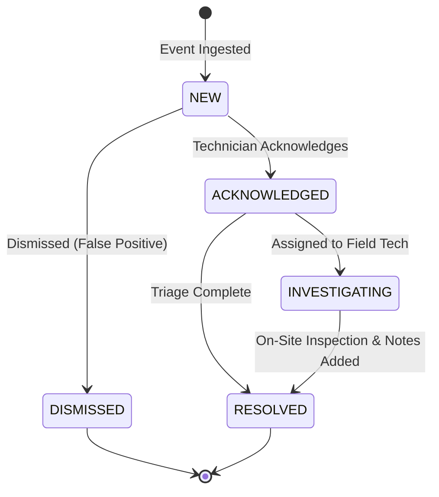

# UNIFIED ALARM ENGINE ARCHITECTURE
## Severity Rating, Lifecycle State Machine & Cooldown Deduplication

**Company:** Tech Defence Solutions  
**Product:** CCTV SENTINEL UNIVERSAL  
**Module:** `backend/pkg/alarms`  
**Phase:** 7  

---

## 1. Alarm Normalization Model

The Unified Alarm Engine translates hundreds of vendor-specific event topics into a clean, normalized `Alarm` structure:

```go
type Alarm struct {
    ID                  string                 `json:"id"`
    DeviceID            string                 `json:"device_id"`
    DeviceName          string                 `json:"device_name"`
    ChannelID           int                    `json:"channel_id"`
    Category            string                 `json:"category"`
    Severity            AlarmSeverity          `json:"severity"` // CRITICAL, MAJOR, MINOR, INFO
    State               AlarmState             `json:"state"`    // NEW, ACKNOWLEDGED, INVESTIGATING, RESOLVED, DISMISSED
    EventID             string                 `json:"event_id"`
    EventTopic          string                 `json:"event_topic"`
    EventTimestamp      time.Time              `json:"event_timestamp"`
    FirstSeenAt         time.Time              `json:"first_seen_at"`
    LastSeenAt          time.Time              `json:"last_seen_at"`
    OccurrenceCount     int                    `json:"occurrence_count"`
    Description         string                 `json:"description"`
    AssignedTechnician  string                 `json:"assigned_technician,omitempty"`
    ResolutionNotes     string                 `json:"resolution_notes,omitempty"`
    AcknowledgedAt      *time.Time             `json:"acknowledged_at,omitempty"`
    AcknowledgedBy      string                 `json:"acknowledged_by,omitempty"`
    ResolvedAt          *time.Time             `json:"resolved_at,omitempty"`
    ResolvedBy          string                 `json:"resolved_by,omitempty"`
    SnapshotURL         string                 `json:"snapshot_url,omitempty"`
    SnapshotCaptureTime *time.Time             `json:"snapshot_capture_time,omitempty"`
    SnapshotEvidenceID  string                 `json:"snapshot_evidence_id,omitempty"`
    Metadata            map[string]interface{} `json:"metadata,omitempty"`
}
```

---

## 2. Severity Taxonomy

| Severity | Color Code | Criteria | Example Triggers |
|---|---|---|---|
| **`CRITICAL`** | Red (`#ef4444`) | Physical tampering, active perimeter breach, video loss, hardware/disk failure | Camera lens covered, HDD crash, video signal cut |
| **`MAJOR`** | Orange (`#f97316`) | Tripwire crossed, boundary intrusion, WizSense/AcuSense human/vehicle detection | Line crossing outside business hours, unauthorized vehicle in loading bay |
| **`MINOR`** | Amber (`#f59e0b`) | General video motion detection, scene change, audio spike | Motion in hallway during normal operational hours |
| **`INFO`** | Blue (`#3b82f6`) | Operational telemetry, user login, preset tour completed | Technician logged in, guard tour started |

---

## 3. Alarm State Machine Lifecycle



### Transition Guards:
- **`Acknowledge`:** Records technician identity (`AcknowledgedBy`) and UTC timestamp (`AcknowledgedAt`).
- **`Assign`:** Allocates technician call-sign to `AssignedTechnician`.
- **`Resolve`:** Requires non-empty resolution notes (`resolution_notes`) and records `ResolvedBy`.
- **`Dismiss`:** Purges alarm from active queue and logs false-positive audit entry.

---

## 4. Sliding Cooldown Deduplication Window

Repeated video motion triggers or continuous tamper pulses can produce hundreds of redundant events per minute. The alarm engine prevents notification flooding via configurable sliding cooldown windows:
- **Window Duration:** Configurable per rule (default: 10 seconds; range: 1–300s).
- **Matching Key:** `DeviceID + ":" + ChannelID + ":" + Category`.
- **Behavior on Duplicate:** Increments `OccurrenceCount` and updates `LastSeenAt`, but suppresses duplicate notification dispatch, snapshot capture, and webhook requests.
