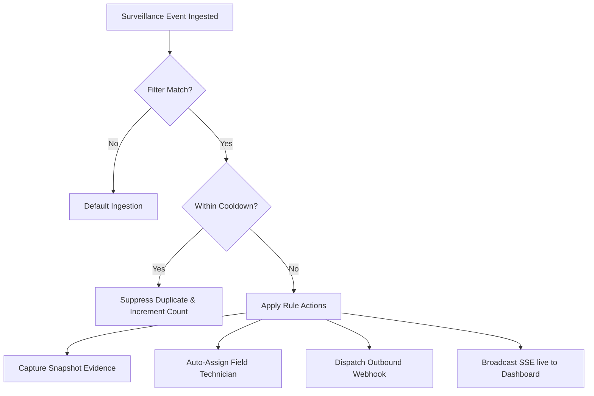

# AUTOMATED ALARM RULES & DISPATCH
## Trigger Filters, Snapshot Automation, Webhooks & Technician Assignment

**Company:** Tech Defence Solutions  
**Product:** CCTV SENTINEL UNIVERSAL  
**Module:** `backend/pkg/alarms`  
**Phase:** 7  

---

## 1. Rule Evaluation Architecture

The rule processor evaluates every incoming normalized event against configured rules in priority order.



---

## 2. Rule Configuration Schema

```go
type AlarmRule struct {
    ID                 string        `json:"id"`
    Name               string        `json:"name"`
    Enabled            bool          `json:"enabled"`
    MatchCategories    []string      `json:"match_categories"`  // e.g. ["TAMPER", "LINE_CROSSING"]
    MatchDeviceIDs     []string      `json:"match_device_ids"`  // Empty = fleet-wide match
    SeverityOverride   AlarmSeverity `json:"severity_override"` // Optional escalation
    CooldownSec        int           `json:"cooldown_sec"`      // Window (seconds)
    CaptureSnapshot    bool          `json:"capture_snapshot"`  // Auto-acquire JPEG evidence
    AssignTechnician   string        `json:"assign_technician"` // Auto-assigned call-sign
    WebhookURL         string        `json:"webhook_url"`       // Outbound HTTP POST
    EmailRecipients    []string      `json:"email_recipients"`
    SuppressDuplicates bool          `json:"suppress_duplicates"`
}
```

---

## 3. Automated Actions

### 3.1 Asynchronous Snapshot Acquisition
If `CaptureSnapshot` is true:
- The engine dispatches a background task to `snapshotEng.CaptureSnapshot(targetDevID)`.
- The acquired JPEG is stored in the secure evidence vault (`./data/snapshots/`).
- The resulting URL (e.g. `/api/v1/snapshots/snap-dev-104-1794082088.jpg`) and independent acquisition timestamp are attached to the `Alarm` model.
- **Truth Rule Compliance:** The engine never delays the alarm record while waiting for the snapshot HTTP request. If frame capture takes 320ms, `Alarm.EventTimestamp` reflects the camera event, while `Alarm.SnapshotCaptureTime` reflects $+320\text{ms}$.

### 3.2 Outbound Webhook Dispatch
When a webhook URL is configured, CCTV SENTINEL issues an HTTP POST with standard JSON:
```json
{
  "event_type": "ALARM_TRIGGERED",
  "alarm_id": "alm-dev-192-168-31-104-tamper-1794082080",
  "device_id": "dev-192-168-31-104",
  "device_name": "Vatilon H43",
  "category": "TAMPER",
  "severity": "CRITICAL",
  "description": "Camera lens covered or sprayed",
  "event_timestamp": "2026-11-08T07:45:12.100Z",
  "snapshot_url": "/api/v1/snapshots/snap-1794082080.jpg"
}
```
**OPSEC Secret Redaction:** Credentials, API tokens, and encryption keys are strictly omitted or redacted with `[REDACTED]` prior to dispatch.
