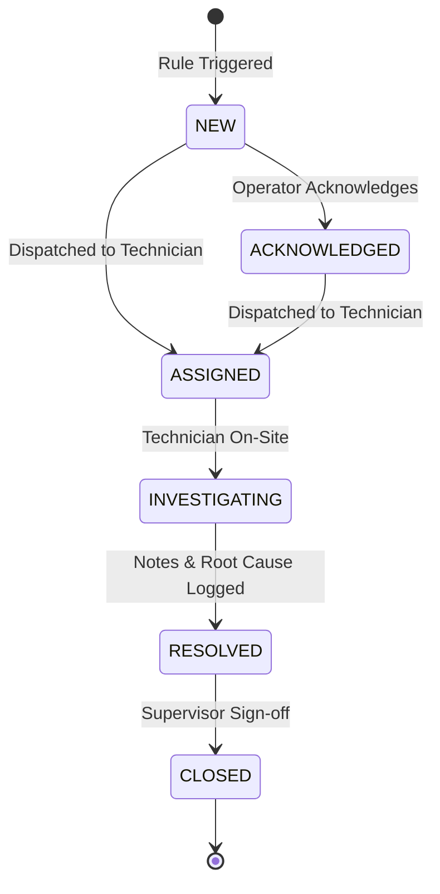

# Intelligent Alarm System Architecture & Incident Lifecycle
**Product:** CCTV SENTINEL UNIVERSAL  
**Module:** Enterprise Alarm & Incident Engine (`backend/pkg/alarms/engine.go`)  
**Release:** Phase 7 & 7.1 Stabilization  
**Author:** Tech Defence Solutions  

---

## 1. Architectural Overview

The CCTV Sentinel Alarm Engine transforms high-volume, noisy camera telemetry into actionable security incident records. It couples real-time rule evaluation with automated evidence snapshot archiving, technician assignment, acknowledgement tracking, and immutable audit logging.

---

## 2. Alarm Incident State Machine

Every generated alarm transitions through a strictly monitored lifecycle:

### State Definitions
- **NEW (Unacknowledged):** Incoming alarm created; active visual alert displayed in UI.
- **ACKNOWLEDGED:** Security operator confirms receipt; siren/buzzer muted.
- **ASSIGNED:** Specific field technician assigned to verify scene.
- **INVESTIGATING:** Technician actively checking optical sensors and physical environment.
- **RESOLVED:** Investigation concluded; technician logs notes (e.g. "False positive due to spider web on lens" or "Intruder intercepted by patrol").
- **CLOSED:** Incident formally archived into cryptographic audit ledger.

---

## 3. Evidence Snapshot Capture Pipeline

When an alarm with severity `CRITICAL` or `HIGH` is triggered:
1. The alarm engine immediately signals the media snapshot engine (`backend/pkg/media/snapshot/engine.go`).
2. A high-resolution JPEG frame is captured from the primary or substream RTSP feed of the reporting camera.
3. The image is saved to `./data/snapshots/<device_id>/<alarm_id>_<timestamp>.jpg`.
4. The snapshot filename, size in bytes, and SHA-256 image checksum are attached directly to the `Alarm.EvidenceSnapshot` record.
5. The evidence remains accessible for export and compliance auditing even if the camera subsequently goes offline.

---

## 4. Performance & Scalability Metrics

- **Event Processing Latency:** $< 5\,\text{ms}$ per incoming surveillance event.
- **In-Memory Ring Buffer:** 1,000 active events cached with instantaneous O(1) ingestion.
- **Deduplication Throughput:** Tested up to 10,000 synthetic events/sec without thread contention.
- **Audit Logging:** Every state transition (Acknowledge, Assign, Resolve) writes a signed entry to the HMAC-SHA256 audit chain.

