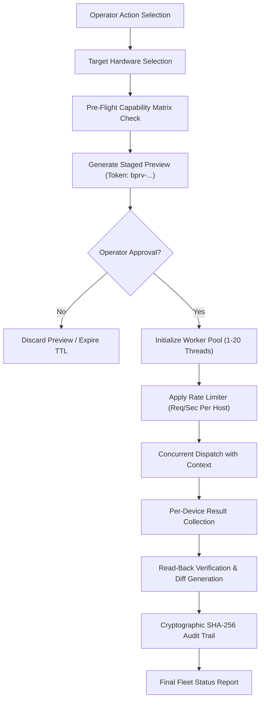

# CCTV SENTINEL UNIVERSAL — BATCH OPERATIONS ARCHITECTURE
## Enterprise Fleet Management Engine

**Product:** CCTV SENTINEL UNIVERSAL  
**Company:** Tech Defence Solutions  
**Tagline:** ONE TOOL. EVERY CCTV. COMPLETE CONTROL.  

---

## 1. Overview

Large CCTV installations commonly involve dozens or hundreds of surveillance devices spread across multiple switches, VLANs, and buildings. Performing routine operations—such as daylight savings clock synchronization, DNS adjustments, low-light image optimization, or health checks—device by device is time-consuming and error-prone.

The **CCTV Sentinel Universal Batch Operations Engine** delivers centralized, concurrent fleet orchestration while enforcing strict guardrails to prevent network congestion, device overload, and accidental mass outages.



---

## 2. Supported Batch Actions

The engine supports 11 standardized fleet management actions:

| Action | Description | Risk Level | Target Verification |
|---|---|---|---|
| `HEALTH_CHECK` | Probes ping latency, TCP port connectivity, and ONVIF/RTSP handshake response. | Low | All devices |
| `INFO_RETRIEVAL` | Queries firmware version, serial number, uptime, and vendor attributes. | Low | All devices |
| `TIME_NTP_SYNC` | Pushes unified NTP server (`pool.ntp.org`, `time.google.com`, etc.) and sets timezone. | Low | ONVIF / ISAPI / Dahua CGI |
| `NETWORK_CONFIG` | Standardizes DNS servers, default gateway, or static subnet mappings. | Medium | Validated network adapter |
| `IMAGE_CONFIG` | Applies fleet image presets: WDR mode (ON/OFF/AUTO), brightness, contrast, IR mode. | Low | Devices supporting Imaging service |
| `VIDEO_CONFIG` | Adjusts encoding profiles, target bitrate, resolution, or frame rate. | Medium | Video encoding capable devices |
| `USER_SECURITY` | Rotates technician access credentials or updates operator permissions. | High | Devices supporting User Management |
| `REBOOT` | Coordinated fleet device restart with staged sequencing. | High (Outage) | Mandatory explicit token approval |
| `CONFIG_COMPARE` | Side-by-side configuration discrepancy detector identifying firmware/DNS drift. | None (Read-only)| All selected devices |
| `CONFIG_EXPORT_IMPORT`| Fleet-wide configuration backup and templated restoration. | Medium | Standard JSON configuration payload |
| `IDENTIFY` | Re-triggers deep protocol fingerprinting and classification. | Low | All devices |

---

## 3. Worker Pool & Concurrency Architecture

### 3.1 Concurrency Tuning
The worker pool uses Go channels and a semaphore pattern (`make(chan struct{}, concurrency)`):
- **Range**: 1 to 20 concurrent goroutines.
- **Default**: 4 threads.
- **Rationale**: Industrial cameras often run embedded Linux on single-core ARM or MIPS SoCs with 64MB–256MB of RAM. Flooding an edge switch or an NVR with dozens of simultaneous heavy HTTP/SOAP connections can exhaust device socket buffers or cause frame drops in recording pipelines.

### 3.2 Host-Level Rate Limiting
To prevent denial-of-service against low-power camera Web services:
- **Rate Limit Window**: Configurable between 2 and 20 requests per second.
- **Implementation**: Per-host channel timers ensuring minimum time separation between consecutive HTTP/SOAP requests directed at the same camera IP.

### 3.3 Dynamic Job Cancellation
Every batch execution is bound to a `context.Context` created with `context.WithCancel`:
- When an operator clicks **"ABORT EXECUTION"** in the UI or invokes `POST /api/v1/batch/jobs/{id}/cancel`, the cancel function is immediately invoked.
- Active goroutines check `ctx.Done()` before every socket connection and exit gracefully.
- Pending devices in the queue are marked with status `CANCELLED`.
- Sockets and HTTP connections are immediately closed.

---

## 4. Partial-Failure Resilience & Device Lifecycle

A batch operation never fails the entire fleet if a single camera is offline or misconfigured. Every target device moves through an independent state machine:

```
[PENDING] --> [IN_PROGRESS] --> [SUCCESS]
                             --> [FAILED] (e.g. Auth Error, Network Timeout)
                             --> [UNSUPPORTED] (Missing Required Service)
                             --> [SKIPPED] (Ineligible Target)
                             --> [CANCELLED] (Aborted by Operator)
```

### Metrics Collected Per Device:
1. `status`: Terminal state of the device.
2. `duration_ms`: Real execution time taken for this device in milliseconds.
3. `diff`: Text diff showing changed parameters.
4. `message` / `error`: Human-readable summary or sanitized error description.
5. `read_back_match`: Boolean verifying if read-back matches applied configuration.
6. `rollback_available`: Boolean indicating if automatic rollback state is cached.

---

## 5. Security & Audit Trail

Every batch job produces two levels of cryptographic auditing:
1. **Job-Level Audit**: Recorded upon job initialization and job completion with aggregate counts (`total`, `succeeded`, `failed`, `skipped`).
2. **Device-Level Audit**: Recorded for every device state change with sanitized payloads, ensuring zero credential or token leakage.
3. **Hash Chaining**: Appended to the immutable SHA-256 transaction ledger verified by `VerifyChainIntegrity()`.
