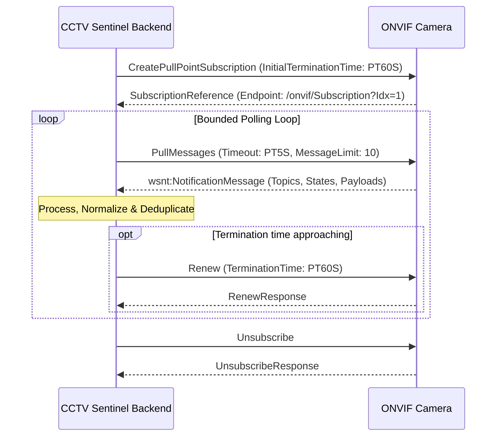

# ONVIF EVENT MANAGEMENT & PULLPOINT ARCHITECTURE
## Subscription Lifecycle, SOAP Messaging, XML Parsing & Topic Filtering

**Company:** Tech Defence Solutions  
**Product:** CCTV SENTINEL UNIVERSAL  
**Module:** `backend/pkg/events`  
**Phase:** 7  

---

## 1. Overview of ONVIF PullPoint Architecture

ONVIF defines two event notification mechanisms:
1. **Basic Notification (Push):** Camera attempts to establish an HTTP callback to the client. This frequently fails in technician deployments due to firewall NAT and dynamic technician laptop IPs.
2. **PullPoint Subscription (Pull):** The client creates a subscription on the camera and periodically polls the dedicated subscription endpoint for messages using `PullMessages`. This is robust, NAT-traversing, and enterprise-reliable.

CCTV SENTINEL implements the complete **PullPoint** lifecycle with automated renewal and bounded backoff.

---

## 2. Subscription Lifecycle



---

## 3. SOAP XML Message Construction

### 3.1 CreatePullPointSubscription
```xml
<?xml version="1.0" encoding="utf-8"?>
<soap:Envelope xmlns:soap="http://www.w3.org/2003/05/soap-envelope"
               xmlns:wsa="http://www.w3.org/2005/08/addressing"
               xmlns:tev="http://www.onvif.org/ver10/events/wsdl">
  <soap:Header>
    <wsa:Action>http://www.onvif.org/ver10/events/wsdl/EventPortType/CreatePullPointSubscriptionRequest</wsa:Action>
    <wsa:MessageID>urn:uuid:7c0e81b6-1234-4567-89ab-cdef01234567</wsa:MessageID>
  </soap:Header>
  <soap:Body>
    <tev:CreatePullPointSubscription>
      <tev:InitialTerminationTime>PT60S</tev:InitialTerminationTime>
    </tev:CreatePullPointSubscription>
  </soap:Body>
</soap:Envelope>
```

### 3.2 PullMessages
```xml
<?xml version="1.0" encoding="utf-8"?>
<soap:Envelope xmlns:soap="http://www.w3.org/2003/05/soap-envelope"
               xmlns:tev="http://www.onvif.org/ver10/events/wsdl">
  <soap:Body>
    <tev:PullMessages>
      <tev:Timeout>PT5S</tev:Timeout>
      <tev:MessageLimit>10</tev:MessageLimit>
    </tev:PullMessages>
  </soap:Body>
</soap:Envelope>
```

---

## 4. XML Topic Parsing & Normalization

ONVIF delivers topics using the `Concrete` topic expression dialect:
- `tns1:RuleEngine/TamperDetector/Tamper` $\to$ Normalized Category: **`TAMPER`**, Severity: **`CRITICAL`**
- `tns1:VideoSource/MotionAlarm` $\to$ Normalized Category: **`MOTION`**, Severity: **`MINOR`**
- `tns1:RuleEngine/LineDetector/Crossed` $\to$ Normalized Category: **`LINE_CROSSING`**, Severity: **`MAJOR`**
- `tns1:RuleEngine/FieldDetector/ObjectsInside` $\to$ Normalized Category: **`INTRUSION`**, Severity: **`MAJOR`**
- `tns1:Device/Trigger/DigitalInput` $\to$ Normalized Category: **`IO_ALARM`**, Severity: **`INFO`**
- `tns1:Device/HardwareFailure/StorageFailure` $\to$ Normalized Category: **`DEVICE_FAULT`**, Severity: **`CRITICAL`**

The parser extracts:
- Topic string
- Source item (Token, Channel index)
- Data item `State` (`true` = START, `false` = STOP)
- UTC timestamp from the notification header
