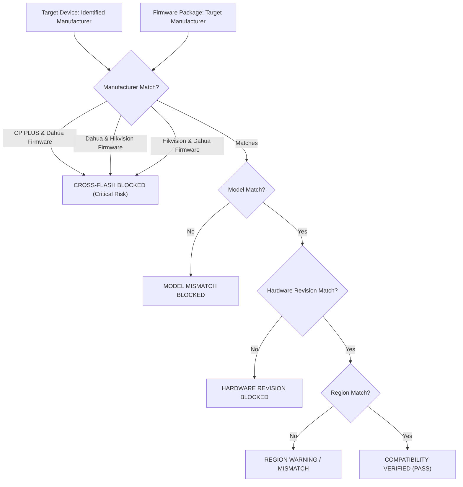

# CCTV SENTINEL UNIVERSAL — FIRMWARE COMPATIBILITY MATRIX & CROSS-FLASH GUARD
## OEM Rebranding Analysis, Hardware Revision Matching & Anti-Brick Protection

**Product:** CCTV SENTINEL UNIVERSAL  
**Company:** Tech Defence Solutions  
**Tagline:** ONE TOOL. EVERY CCTV. COMPLETE CONTROL.  

---

## 1. The Cross-Flash Vulnerability in CCTV Deployments

In the surveillance hardware industry, many cameras share underlying system-on-chip (SoC) architectures (e.g. HiSilicon, Ambarella, Grain Media, MStar, SigmaStar). A prominent example is the relationship between **Dahua Technology** (original design manufacturer) and **CP PLUS** (rebranded and customized OEM distribution in India and global markets).

While the underlying hardware may appear similar:
1. **Bootloader Header Signatures**: CP PLUS bootloaders verify digital OEM signatures. Flashing a generic Dahua `.bin` file onto CP PLUS hardware frequently bricks the device because the bootloader rejects the Dahua signature midway or corrupts the root filesystem partition table.
2. **Flash Memory Partition Layout**: Partition offsets for `u-boot`, `kernel`, `romfs`, and `custom` data often differ by several kilobytes between OEM builds. An offset mismatch overwrites partition metadata, rendering the camera unbootable.
3. **Cryptographic Certificate Enclaves**: Modern Dahua and CP PLUS cameras contain unique hardware encryption keys in secure keystores. Cross-flashing destroys certificate alignment, permanently breaking HTTPS and P2P cloud connectivity.

---

## 2. Strict Cross-Flash Protection Logic

The `firmware.Engine` actively inspects both the device's identified manufacturer and the firmware package metadata before allowing preview or execution:



### Direct Rule Implementation (`backend/pkg/firmware/engine.go`):
```go
// Check for Cross-Flash attempt between OEM and Parent Brand
if (strings.EqualFold(dev.Manufacturer, "CP PLUS") && strings.EqualFold(pkg.Manufacturer, "Dahua")) ||
   (strings.EqualFold(dev.Manufacturer, "Dahua") && strings.EqualFold(pkg.Manufacturer, "CP PLUS")) ||
   (!strings.EqualFold(dev.Manufacturer, pkg.Manufacturer)) {
    elig.Eligible = false
    elig.CrossFlashRisk = true
    elig.CrossFlashDetails = fmt.Sprintf(
        "CRITICAL MISMATCH: Device is %s but firmware is signed for %s. Cross-flashing OEM brands is prohibited.",
        dev.Manufacturer, pkg.Manufacturer,
    )
    elig.ValidationErrors = append(elig.ValidationErrors, elig.CrossFlashDetails)
    return elig, nil
}
```

---

## 3. Hardware Revision Guardrails

Manufacturers frequently release multiple internal hardware revisions of the same commercial camera model while keeping the model name identical:

| Model | HW Revision | Chipset | Compatible Firmware | Incompatible Firmware |
|---|---|---|---|---|
| Dahua DH-IPC-HFW1230T1P-ZS | `S2` | HiSilicon Hi3516EV100 | `V2.800.0000000.10.R` | `S4` or `S5` builds |
| Dahua DH-IPC-HFW1230T1P-ZS | `S4` | MStar MSC313E | `V2.820.0000000.38.R` | `S2` builds (Bricks SoC) |
| Hikvision DS-2CD2043G2-I | `G2-REV-A` | Ambarella S2L | `V5.5.x` | `V5.7.x` G2-REV-B |
| Hikvision DS-2CD2043G2-I | `G2-REV-B` | Novatek NT9856x | `V5.7.1 build 230915`| `G2-REV-A` binaries |
| CP PLUS CP-UNC-TA21PL3 | `V2` | HiSilicon | `V2.400.x` | `V3` builds |
| CP PLUS CP-UNC-TA21PL3 | `V3` | SigmaStar | `V2.800.0000000.18.R` | `V2` builds |

CCTV Sentinel Universal compares the camera's internal hardware revision code (extracted from `GetDeviceInformation` or ISAPI device system XML) against the package's `HardwareRevision` tag. If they do not match, the preview flags:
`"Hardware revision mismatch: Device is revision [S2] but firmware package targets revision [S4]"`.

---

## 4. Region & Language Lock Protection

Flashing firmware compiled for an incorrect geographic region causes severe field failures:
1. **Chinese Domestic Market Firmware (`CN`)**: Flashed onto Global, Indian (`IN`), or European (`EU`) cameras will force the GUI into Mandarin, disable RTSP authentication options, and trigger country-code mismatch locks.
2. **Indian Region (`IN`)**: Required for CP PLUS and Dahua-IN models to maintain compliance with BIS (Bureau of Indian Standards) and ensure compatibility with local cloud relay nodes.
3. **Global Multi-Language (`GLOBAL`)**: Intended for international retail releases.

CCTV Sentinel Universal evaluates region codes and surfaces immediate warnings if a technician attempts to cross regions.
