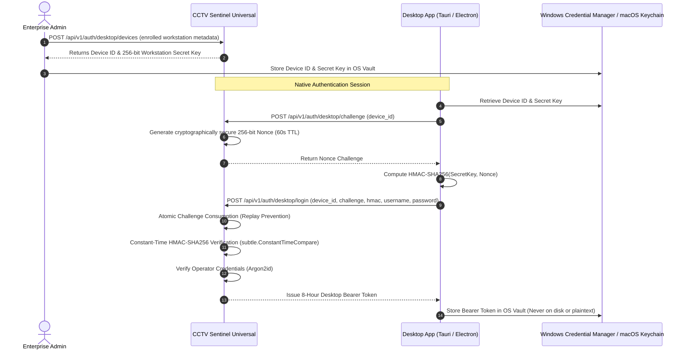

# CCTV SENTINEL UNIVERSAL — Production Deployment & Security Architecture Guide

**Owner:** Tech Defence Solutions  
**Platform Version:** v1.0.0  
**Security Classification:** Enterprise Restricted  
**Applicability:** Production Deployments, Reverse Proxies, TLS Termination, Desktop Agent Integration

---

## 1. Production Cookie Security & Reverse Proxy Architecture

### 1.1 Secure Cookie Configuration Flags
In production environments, session management runs exclusively over HTTPS with strict cookie boundaries to prevent cross-site request forgery, cross-subdomain injection, and token extraction.

| Environment Variable | Recommended Value | Purpose |
|----------------------|-------------------|---------|
| `SENTINEL_ENV` | `production` | Disables development HTTP defaults (including `localhost` origins). |
| `SENTINEL_SECURE_COOKIES` | `true` | Enforces the `Secure` flag on all `Set-Cookie` directives. |
| `SENTINEL_COOKIE_HOST_PREFIX` | `true` | Enforces the RFC 6265bis `__Host-` cookie prefix (`__Host-sentinel_session` and `__Host-sentinel_csrf`), guaranteeing path `/`, secure transport, and no domain attribute. |
| `SENTINEL_ALLOWED_ORIGINS` | `https://cctv.company.com` | Strict comma-separated list of authorized browser origins. Localhost is never trusted in production. |
| `SENTINEL_TRUSTED_PROXIES` | `10.0.0.1/32,172.16.0.0/12` | Comma-separated list of trusted upstream reverse-proxy IPs or CIDRs allowed to forward `X-Forwarded-Proto`. |

### 1.2 Upstream Reverse-Proxy Validation (Anti-Spoofing)
Untrusted clients frequently forge `X-Forwarded-Proto: https` to trick backend servers into issuing secure cookies over unencrypted channels.
Sentinel Universal defends against this by evaluating `r.RemoteAddr` against `s.cookieConfig.TrustedProxies`:
- If `r.RemoteAddr` matches a configured proxy CIDR, `X-Forwarded-Proto: https` is recognized.
- If `r.RemoteAddr` is unlisted or directly from an untrusted client, `X-Forwarded-Proto` is discarded and cookie transport security falls back to direct TLS evaluation (`r.TLS != nil`) or explicit `SENTINEL_SECURE_COOKIES`.

### 1.3 Production NGINX Reverse Proxy Configuration
```nginx
# /etc/nginx/sites-available/sentinel.conf
upstream sentinel_backend {
    server 127.0.0.1:8080;
    keepalive 32;
}

server {
    listen 80;
    server_name cctv.company.internal;
    return 301 https://$host$request_uri;
}

server {
    listen 443 ssl http2;
    server_name cctv.company.internal;

    ssl_certificate /etc/ssl/certs/sentinel.crt;
    ssl_certificate_key /etc/ssl/private/sentinel.key;
    ssl_protocols TLSv1.2 TLSv1.3;
    ssl_ciphers HIGH:!aNULL:!MD5:!3DES;
    ssl_prefer_server_ciphers on;

    # Strict Transport Security & Origin Hardening
    add_header Strict-Transport-Security "max-age=63072000; includeSubDomains; preload" always;
    add_header X-Content-Type-Options "nosniff" always;
    add_header X-Frame-Options "DENY" always;

    # Forwarded headers — trusted by Sentinel backend via SENTINEL_TRUSTED_PROXIES
    proxy_set_header Host $host;
    proxy_set_header X-Real-IP $remote_addr;
    proxy_set_header X-Forwarded-For $proxy_add_x_forwarded_for;
    proxy_set_header X-Forwarded-Proto https;

    # API Proxy
    location /api/ {
        proxy_pass http://sentinel_backend;
        proxy_http_version 1.1;
        proxy_set_header Connection "";
        proxy_read_timeout 90s;
    }

    # WebSocket / SSE Event Stream
    location /api/v1/alarms/ws {
        proxy_pass http://sentinel_backend;
        proxy_http_version 1.1;
        proxy_set_header Upgrade $http_upgrade;
        proxy_set_header Connection "upgrade";
        proxy_read_timeout 3600s;
    }

    # Static UI bundle
    location / {
        root /var/www/sentinel/dist;
        index index.html;
        try_files $uri $uri/ /index.html;
    }
}
```

---

## 2. Desktop Authentication Trust Model

### 2.1 Threat Mitigation: Header Spoofing Elimination
In legacy versions, client-supplied headers like `X-Client-Type: desktop` bypassed browser Origin validation and returned bearer session tokens in JSON bodies.
**Phase 6.1.6 eliminates this vulnerability:**
- `X-Client-Type` header bypass has been completely removed.
- Browser authentication (`/api/v1/auth/login`) is strictly cookie-based, requires a validated `Origin` header from `SENTINEL_ALLOWED_ORIGINS`, and NEVER issues bearer tokens in the response body.
- Desktop clients use a cryptographically isolated challenge-response workflow against dedicated endpoints (`/api/v1/auth/desktop/challenge` and `/api/v1/auth/desktop/login`).

### 2.2 Workstation Registration & Challenge-Response Flow


### 2.3 Operating System Credential Vault Integration
Desktop clients must store their provisioned workstation keys and active bearer tokens using platform-native secure credential storage:
- **Windows:** Windows Credential Manager (`wincred` API via DPAPI).
- **macOS:** Apple Keychain Services (`Security.framework`).
- **Linux:** Secret Service API via `libsecret` / FreeDesktop D-Bus.

---

## 3. First-Run Administrator Provisioning & Secret Hygiene

### 3.1 Zero-Default-Credential Policy
CCTV Sentinel Universal does NOT ship with hardcoded default accounts, default passwords (`Admin@Sentinel2026!`, `admin123`), or backdoor credentials.

1. **Initial Boot:** On fresh startup with an empty user store, the server enters `setupMode = true` and generates a single-use 256-bit cryptographically secure setup token (`sent-setup-<hex>`).
2. **Local Token File:** The token is persisted to `sentinel-setup.token` with restricted filesystem permissions (`0600`).
3. **Atomic Completion:** The operator submits the setup token along with their chosen master password (minimum 10 characters with uppercase, lowercase, digit, and symbol).
4. **Permanent Invalidation:** The setup token is destroyed immediately from memory and the `sentinel-setup.token` file is erased from disk. All subsequent calls to `/api/v1/auth/setup` return HTTP 403 `SETUP_DISABLED`.
5. **Secret Redaction:** Setup tokens, session keys, and camera credentials must NEVER be logged to audit ledgers, console outputs, or Git commits.
