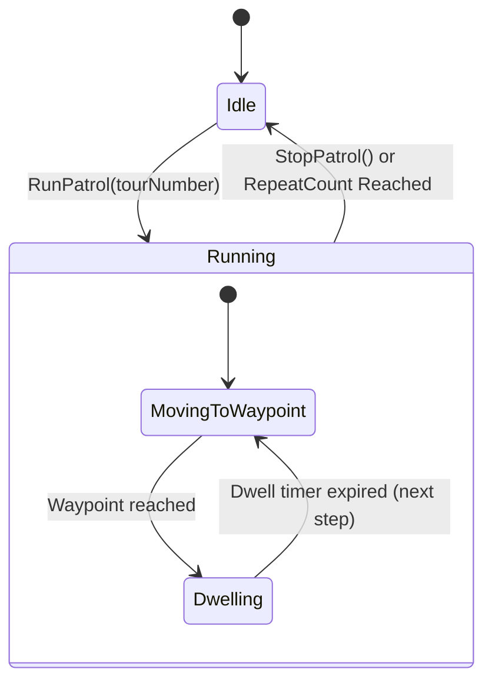

# UNIVERSAL PTZ CONTROL ENGINE
## Architecture, Velocity Vectors, Presets & Patrol Cruising

**Company:** Tech Defence Solutions  
**Product:** CCTV SENTINEL UNIVERSAL  
**Module:** `backend/pkg/ptz`  
**Phase:** 7  

---

## 1. Overview & Mechanical Principles

Pan-Tilt-Zoom (PTZ) cameras utilize electromechanical stepper or servo motors to position the optical assembly across spherical coordinates. The Universal PTZ Control Engine provides an abstraction layer that normalizes PTZ commands across diverse protocols:
- **ONVIF Profile S & T PTZ Service:** SOAP/XML velocity vector commands.
- **Hikvision ISAPI PTZ:** RESTful HTTP PUT `/ISAPI/PTZCtrl/channels/{ch}/continuous` and `momentary`.
- **Dahua CGI PTZ:** HTTP GET `/cgi-bin/ptz.cgi?action=start&channel={ch}&code={cmd}&arg1=0&arg2={speed}&arg3=0`.
- **CP PLUS / Pelco-D / UTC:** RS-485 / coaxial telemetry commands via XVR/DVR.

---

## 2. Velocity Vector Coordinate Space

All velocity vectors are normalized to floating-point values between `-1.0` and `+1.0`:
- **Pan Velocity ($v_x$):**
  - $-1.0 \le v_x < 0$: Pan Left (counter-clockwise looking down at mounting).
  - $0 < v_x \le 1.0$: Pan Right (clockwise).
  - $v_x = 0$: Motor idle.
- **Tilt Velocity ($v_y$):**
  - $-1.0 \le v_y < 0$: Tilt Down.
  - $0 < v_y \le 1.0$: Tilt Up.
  - $v_y = 0$: Motor idle.
- **Zoom Velocity ($v_z$):**
  - $-1.0 \le v_z < 0$: Zoom Wide (optical focal length decreases).
  - $0 < v_z \le 1.0$: Zoom Tele (optical focal length increases).
  - $v_z = 0$: Zoom motor idle.

### Diagonal Move Synthesis
When diagonal directional buttons are pressed on the frontend console (e.g. Up-Right), the engine synthesizes equal velocity vectors ($v_x = 0.707 \cdot \text{speed}$, $v_y = 0.707 \cdot \text{speed}$), preserving consistent angular velocity magnitude:
$$\|\vec{v}\| = \sqrt{v_x^2 + v_y^2} \approx \text{speed}$$

---

## 3. Preset Memory Management

The PTZ engine maintains preset position records stored in device NVRAM as well as the platform database:
1. **Creation:** Current coordinate vectors $(\theta, \phi, \zeta)$ are sampled from the camera's optical encoder and assigned a preset number (1–128) and descriptive label (e.g. "Gate 1 Entrance", "Loading Bay North").
2. **Recall (`GotoPreset`):** Dispatches the recall instruction to the camera. The internal motor controller computes the optimal trajectory and drives to the target coordinates with high precision ($\le 0.1^\circ$ repeatability).
3. **Renaming & Deletion:** Updates metadata or purges preset indices from memory.

---

## 4. Guard Patrol Cruising State Machine

Patrol tours automate continuous security surveillance along predefined waypoints:

### Configuration Parameters:
- `preset_number`: Target preset coordinate index (1–128).
- `dwell_time_sec`: Time camera remains motionless at the waypoint before advancing (1–300 seconds).
- `speed`: Angular slewing speed between waypoints (1–8).
- `repeat_count`: Number of complete tour loops (0 = infinite continuous cruising).

---

## 5. Emergency Stop Handling

To prevent runaway motor movement when network connectivity glitches or mouse-release events are missed:
1. **Auto-Timeout:** Every `ContinuousMove` carries an explicit server-side timeout (default 1500ms). If no follow-up move or keep-alive is received, the backend dispatches a `Stop` command to the device.
2. **Dedicated Stop Endpoint:** `POST /api/v1/devices/{id}/ptz/stop` issues immediate stop commands to all pan, tilt, zoom, and focus motors.
3. **Hardware Fallback:** Even if protocol adapter resolution fails during patrol termination, the software loop is canceled immediately to guarantee thread safety.
