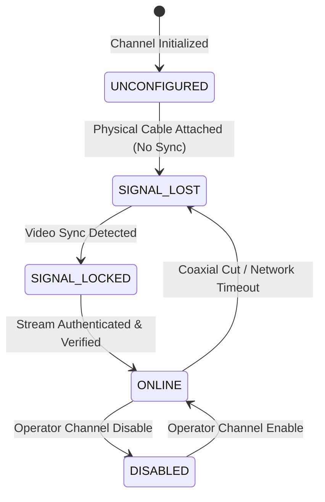

# CCTV SENTINEL UNIVERSAL
## Unified Channel Management Engine

**Company:** Tech Defence Solutions  
**Tagline:** ONE TOOL. EVERY CCTV. COMPLETE CONTROL.  
**Module:** `backend/pkg/recorder`  
**Classification:** Engineering Specification

---

## 1. Channel Numbering Conventions

In video surveillance systems, channel numbering differs fundamentally between device manufacturers:
- **Dahua / CP PLUS XVRs**: Channels 1 through $N$ correspond directly to the physical BNC ports (e.g. Channels 1–8). Expansion IP channels are indexed starting at $N+1$ (e.g. Channels 9–16).
- **Hikvision DVRs / TurboHD**: BNC channels are indexed 1–8. IP channels are indexed starting at 9 or accessed via special D1-D8 virtual identifiers.
- **Pure IP NVRs (e.g. CP PLUS CP-UNR-4K4162-V2)**: Have 0 physical BNC ports. Channels start directly at Channel 1 as digital IP channels up to the maximum rated license (e.g. Channels 1–16).

CCTV Sentinel Universal normalizes this into a unified 1-based display number (`channel_number`) while tracking the underlying hardware channel index (`channel_id`).

---

## 2. Channel Lifecycle & Status States



### 2.1 State Definitions
- `ONLINE`: Video sync established and authenticated frames received.
- `NO_SIGNAL`: Hardware port configured, but no composite video signal or digital transport sync detected.
- `OFFLINE`: Network IP camera disconnected, unreachable, or bad credentials.
- `DISABLED`: Channel disabled by operator policy to save bandwidth or storage.

---

## 3. Channel Mapping Export / Import Specification

Channel mappings can be exported to a portable JSON backup file and imported onto a replacement recorder or used to clone configurations across multi-branch sites:

```json
{
  "recorder_id": "dahua-127-0-0-1-18082",
  "timestamp": "2026-11-07T16:20:20Z",
  "channels": [
    {
      "recorder_id": "dahua-127-0-0-1-18082",
      "channel_id": 1,
      "channel_number": 1,
      "name": "Main Entrance BNC",
      "channel_type": "ANALOG",
      "connection_status": "ONLINE",
      "signal_status": "SIGNAL_LOCKED",
      "signal_format": "CVI",
      "resolution": "1920x1080",
      "frame_rate": 25,
      "bitrate_kbps": 2048,
      "encoding_format": "H.265",
      "recording_status": "CONTINUOUS",
      "audio_enabled": true,
      "ptz_supported": true,
      "rtsp_stream_url": "rtsp://127.0.0.1:554/cam/realmonitor?channel=1&subtype=0"
    }
  ]
}
```

Technicians can export this mapping with one click in Tab 10 ("Mappings Backup") and restore it onto any matching recorder topology.
