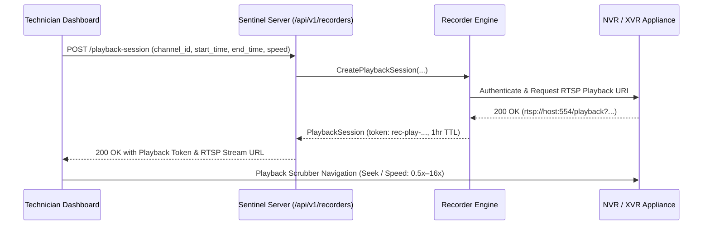

# CCTV SENTINEL UNIVERSAL
## Playback Retrieval, Stream Scrubber & Evidence Export

**Company:** Tech Defence Solutions  
**Tagline:** ONE TOOL. EVERY CCTV. COMPLETE CONTROL.  
**Module:** `backend/pkg/recorder`  
**Classification:** Evidence & Forensics Guide

---

## 1. Overview

Surveillance playback requires rapid search, authenticated streaming, timeline scrubbing, and forensic export. Unlike live feeds, playback involves index queries against the recorder's internal file system or database partition to locate recording clips bounded by `start_time` and `end_time`.

---

## 2. Playback Architecture & Token Security

### 2.1 Playback Session Security
- **Scoped Tokens**: Playback sessions issue cryptographic tokens prefixed with `rec-play-` (e.g. `rec-play-a8b9c0...`).
- **Short-Lived Expiration**: Tokens have a strict 1-hour time-to-live (TTL) and cannot be hijacked or reused indefinitely.
- **Role Isolation**: Only authenticated operators with `TECHNICIAN` or `SECURITY_OFFICER` roles can initialize playback sessions.

---

## 3. Playback Transport & Speeds

The playback engine supports standard VCR/NVR transport commands:
- **Play / Pause / Stop**: Immediate stream control.
- **Variable Playback Speed**:
  - Slow Motion: $0.5\times$
  - Normal Speed: $1.0\times$
  - Fast Forward: $2.0\times$, $4.0\times$, $8.0\times$, $16.0\times$
- **Synchronized Multi-Channel Playback**: Channels 1–4 are synchronized to an identical timecode for incident reconstruction across multiple camera angles simultaneously.

---

## 4. Evidence Export & Path Traversal Defense

When exporting evidence clips for judicial or compliance purposes, `pkg/recorder/engine.go` enforces strict path sanitization:
- **Directory Traversal Protection**: Rejects file paths containing `..`, null bytes (`\0`), or invalid Windows drive letters.
- **Export Formats**: Standard MP4 container with H.264/H.265 video and AAC/G.711 audio, playable in VLC and standard media players without requiring proprietary vendor codecs.
- **Audit Logging**: Every exported file generates an immutable entry in the Merkle-Damgård audit ledger with the exact byte size, MD5/SHA-256 hash, and exporting technician username.
