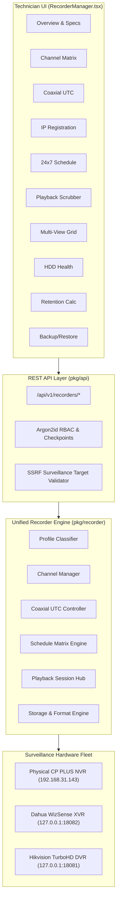

# CCTV SENTINEL UNIVERSAL
## Recorder Architecture & Subsystem Specification

**Company:** Tech Defence Solutions  
**Tagline:** ONE TOOL. EVERY CCTV. COMPLETE CONTROL.  
**Module:** `backend/pkg/recorder`  
**Classification:** Technical Architecture Reference

---

## 1. Overview

Surveillance recorders are multi-channel video ingest, storage, and multiplexing appliances. Unlike standalone IP cameras that encode and stream a single video feed, recorders manage complex hardware arrays comprising physical BNC analog inputs, digital Ethernet ports, internal SATA hard disk arrays, hardware RAID controllers, and multiplexed multi-stream encoders.

CCTV Sentinel Universal establishes an abstraction layer unifying:
- **Digital Network Video Recorders (NVR)**: Pure IP channel multiplexers utilizing ONVIF Profile G, Profile S, RTSP, and vendor private protocols.
- **Hybrid Video Recorders (XVR / HVR)**: Hybrid appliances combining physical BNC analog video inputs with digital IP expansion channels.
- **Digital Video Recorders (DVR)**: Traditional BNC analog video recorders with Coaxial UTC telemetry.



---

## 2. Hardware Classification Matrix

Recorders are classified according to physical hardware capabilities:

| Recorder Type | Physical BNC Analog | IP Digital Expansion | Max Resolution | Coaxial UTC Supported | Supported Signal Modes | Primary Deployment |
| :--- | :---: | :---: | :---: | :---: | :--- | :--- |
| **NVR** | **0** | **4 – 128** | Up to 8K / 12MP | **No** (Guarded) | IP Streams Only | Enterprise IP Surveillance |
| **XVR** | **4 – 32** | **2 – 32** | Up to 4K / 8MP | **Yes** | CVI, TVI, AHD, CVBS, Auto | Hybrid Retrofit Upgrades |
| **DVR** | **4 – 32** | **0 – 4** | Up to 5MP / 4K | **Yes** | TVI, AHD, CVI, CVBS | Legacy Analog Infrastructure |
| **HVR** | **4 – 16** | **4 – 16** | Up to 1080P / 5MP | **Yes** | CVI, TVI, CVBS, IP | Mixed Legacy Sites |

---

## 3. Data Structures & Domain Models

### 3.1 `RecorderProfile`
The fundamental hardware descriptor:
```go
type RecorderProfile struct {
    DeviceID               string         `json:"device_id"`
    Name                   string         `json:"name"`
    IP                     string         `json:"ip"`
    Port                   int            `json:"port"`
    Manufacturer           string         `json:"manufacturer"`
    Model                  string         `json:"model"`
    HardwareRevision       string         `json:"hardware_revision"`
    FirmwareVersion        string         `json:"firmware_version"`
    SerialNumber           string         `json:"serial_number"`
    RecorderType           RecorderType   `json:"recorder_type"`
    PhysicalAnalogChannels int            `json:"physical_analog_channels"`
    SupportedIPChannels    int            `json:"supported_ip_channels"`
    TotalChannels          int            `json:"total_channels"`
    MaxResolution          string         `json:"max_resolution"`
    SupportedAnalogFormats []AnalogFormat `json:"supported_analog_formats"`
    SupportedCodecs        []string       `json:"supported_codecs"`
    CoaxialControlSupported bool           `json:"coaxial_control_supported"`
    AudioOverCoaxSupported  bool           `json:"audio_over_coax_supported"`
    PTZOverCoaxSupported    bool           `json:"ptz_over_coax_supported"`
    AIAnalyticsSupported   bool           `json:"ai_analytics_supported"`
    DiskCount              int            `json:"disk_count"`
    TotalStorageGB         int64          `json:"total_storage_gb"`
    UsedStorageGB          int64          `json:"used_storage_gb"`
    NetworkInterfaces      []string       `json:"network_interfaces"`
}
```

### 3.2 `ChannelInfo`
Models a channel instance on the recorder:
```go
type ChannelInfo struct {
    RecorderID           string        `json:"recorder_id"`
    ChannelID            int           `json:"channel_id"`
    ChannelNumber        int           `json:"channel_number"`
    Name                 string        `json:"name"`
    ChannelType          ChannelType   `json:"channel_type"` // ANALOG | IP
    ConnectedCameraID    string        `json:"connected_camera_id,omitempty"`
    ConnectedCameraIP    string        `json:"connected_camera_ip,omitempty"`
    ConnectedCameraModel string        `json:"connected_camera_model,omitempty"`
    ConnectionStatus     ChannelStatus `json:"connection_status"` // ONLINE | OFFLINE | NO_SIGNAL
    SignalStatus         SignalStatus  `json:"signal_status"`     // SIGNAL_LOCKED | SIGNAL_LOST
    SignalFormat         AnalogFormat  `json:"signal_format"`     // CVI | TVI | AHD | CVBS | IP
    Resolution           string        `json:"resolution"`
    FrameRate            int           `json:"frame_rate"`
    BitrateKbps          int           `json:"bitrate_kbps"`
    EncodingFormat       string        `json:"encoding_format"`
    RecordingStatus      RecordMode    `json:"recording_status"`
    AudioEnabled         bool          `json:"audio_enabled"`
    PTZSupported         bool          `json:"ptz_supported"`
    RTSPStreamURL        string        `json:"rtsp_stream_url,omitempty"`
}
```

---

## 4. Concurrency & Safety Controls

1. **State Isolation**: All channel overrides, active playback sessions, format tokens, and schedule caches are guarded by a `sync.RWMutex` to prevent data races during concurrent technician requests.
2. **SSRF Guard**: Prior to dispatching IP camera registration requests from the recorder to target IP addresses, `security.ValidateSurveillanceTarget(ipStr, false)` validates that the target is a legitimate surveillance subnet endpoint and rejects loopback or cloud metadata IPs.
3. **Audit Ledger Logging**: Every configuration modification, format switch, OSD menu command, and disk format approval is written immediately to the tamper-evident Merkle-Damgård audit ledger with cryptographic HMAC checkpoints.
