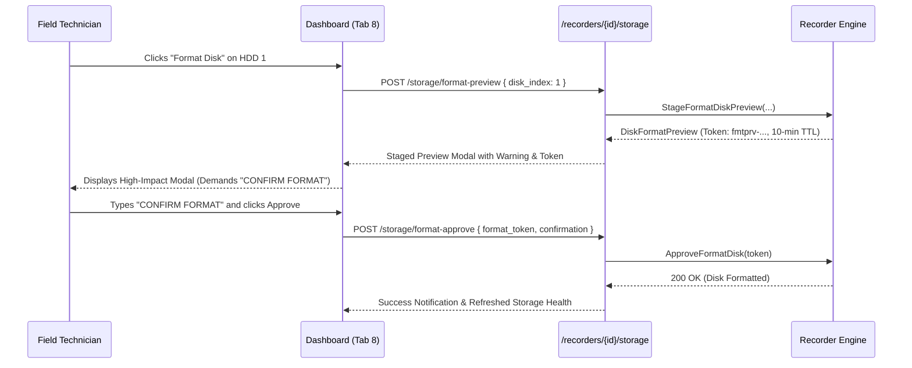

# CCTV SENTINEL UNIVERSAL
## Storage Health, SMART Diagnostics & Disk Safeguards

**Company:** Tech Defence Solutions  
**Tagline:** ONE TOOL. EVERY CCTV. COMPLETE CONTROL.  
**Module:** `backend/pkg/recorder`  
**Classification:** Hardware Maintenance Reference

---

## 1. Surveillance HDDs vs Standard Desktop HDDs

Surveillance recorders generate continuous, uninterrupted 24x7 write streams. Standard desktop hard drives (e.g. Seagate BarraCuda, WD Blue) are designed for intermittent 8x5 read/write workloads and will fail rapidly in an NVR. Surveillance-grade drives (e.g. Seagate SkyHawk, Western Digital Purple):
- Support 24x7 continuous write workloads up to 180 TB/year.
- Feature ATA streaming command set optimizations (AllFrame / ImagePerfect) to prevent frame drops.
- Include rotational vibration (RV) sensors for dense multi-bay chassis.

---

## 2. SMART Health & Predictive Diagnostics

CCTV Sentinel Universal tracks critical S.M.A.R.T. (Self-Monitoring, Analysis and Reporting Technology) attributes:
- **Operating Temperature**: Surveillance drives should operate between $30^\circ\text{C}$ and $45^\circ\text{C}$. Drives exceeding $50^\circ\text{C}$ trigger thermal warning alerts.
- **Reallocated Sector Count (Attribute 5)**: When a hard drive encounters bad sectors, it reallocates them to spare reserved tracks. Any count $> 0$ indicates physical platter degradation.
- **Current Pending Sector Count (Attribute 197)**: Unstable sectors awaiting reallocation. A rising count signals imminent drive failure.

---

## 3. Storage Retention Estimation Formula

Storage retention days are calculated using the standard CCTV bitrate formula:

$$\text{Daily Storage (GB)} = \frac{\text{Channels} \times \text{Avg Bitrate (kbps)} \times 3600 \times \text{Hours/Day}}{8 \times 1024 \times 1024}$$

$$\text{Total Retention Days} = \frac{\text{Total HDD Capacity (GB)}}{\text{Daily Storage (GB)}}$$

### Example Calculation:
For an 8-channel system recording 24 hours/day at an average bitrate of 4096 kbps (4MP H.265) on a 4000 GB (4TB) hard drive:
$$\text{Daily Storage} = \frac{8 \times 4096 \times 3600 \times 24}{8,388,608} \approx 337.5\text{ GB/day}$$
$$\text{Retention} = \frac{4000\text{ GB}}{337.5\text{ GB/day}} \approx 11.85\text{ Days}$$

---

## 4. High-Impact Format Disk Safeguard Workflow

Formatting an NVR hard disk erases all recorded video evidence permanently. To prevent accidental data loss, CCTV Sentinel Universal implements a mandatory two-stage confirmation gate:

If the token expires ($>10$ minutes) or the confirmation string does not match exactly, the operation is blocked with HTTP status code `422 Unprocessable Entity`.
