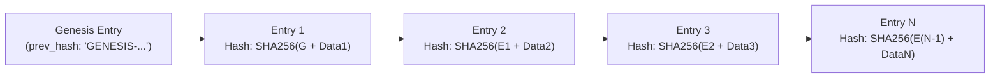

# CCTV SENTINEL UNIVERSAL — TAMPER-EVIDENT AUDIT LOGGING
## Cryptographic Hash Chaining, Secret Redaction & Commissioning Verification

**Product:** CCTV SENTINEL UNIVERSAL  
**Company:** Tech Defence Solutions  
**Tagline:** ONE TOOL. EVERY CCTV. COMPLETE CONTROL.  

---

## 1. Cryptographic Hash Chaining Mechanics

Standard database audit tables can be silently altered or truncated by an attacker with local database access. To provide mathematical proof of log integrity, CCTV Sentinel Universal implements a **Merkle-style linear cryptographic hash chain**:



### Mathematical Formula:
$$H_0 = \text{SHA256}(\text{"GENESIS-CCTV-SENTINEL-UNIVERSAL-LEDGER"})$$
$$H_i = \text{SHA256}(H_{i-1} \parallel \text{timestamp}_i \parallel \text{user}_i \parallel \text{device\_ip}_i \parallel \text{action}_i \parallel \text{details}_i \parallel \text{status}_i)$$

Where:
- $H_{i-1}$ is the `prev_hash` field stored in entry $i$.
- $H_i$ is the `entry_hash` calculated and stored in entry $i$.
- $\parallel$ represents string concatenation with a strict delimiter (`|`).

If an adversary alters a past entry (e.g. changing an action from `REBOOT` to `STATUS_CHECK` or deleting an unauthorized password change), the recomputed hash $H_i$ will not match the recorded `entry_hash`, and the subsequent entry's `prev_hash` will fail validation.

---

## 2. Integrity Verification Algorithm (`VerifyChainIntegrity`)

The verification engine (`backend/pkg/audit/audit.go`) inspects the complete chain from the genesis block to the latest entry:

```go
func (l *Logger) VerifyChainIntegrity() (bool, int, error) {
    l.mu.RLock()
    defer l.mu.RUnlock()

    if len(l.entries) == 0 {
        return true, 0, nil
    }

    expectedPrev := "GENESIS-CCTV-SENTINEL-UNIVERSAL-LEDGER"
    for idx, entry := range l.entries {
        // 1. Verify that this entry points to the previous entry's hash
        if entry.PrevHash != expectedPrev {
            return false, idx, fmt.Errorf("hash chain broken at entry %d (%s): prev_hash mismatch", idx, entry.ID)
        }

        // 2. Recompute this entry's hash from its fields
        raw := fmt.Sprintf("%s|%s|%s|%s|%s|%s|%s",
            entry.PrevHash, entry.Timestamp, entry.User, entry.DeviceIP, entry.Action, entry.Details, entry.Status)
        recomputed := fmt.Sprintf("%x", sha256.Sum256([]byte(raw)))

        if entry.EntryHash != recomputed {
            return false, idx, fmt.Errorf("tamper detected at entry %d (%s): entry_hash mismatch", idx, entry.ID)
        }

        expectedPrev = entry.EntryHash
    }

    return true, len(l.entries), nil
}
```

Technicians can trigger verification at any time via the UI **"Verify Integrity"** button or through `GET /api/v1/audit/verify`.

---

## 3. Secret Scrubbing & Redaction Engine

Audit logs must never become a source of credential leakage. All strings logged through `logger.Log()` pass through `ScrubSecrets()`:

### Active Regex Filters:
1. **JSON Password Fields**:
   - Pattern: `(?i)("password"\s*:\s*)"[^"]*"`
   - Replacement: `${1}"[REDACTED]"`
2. **HTTP Basic Authentication**:
   - Pattern: `(?i)(Basic\s+)[A-Za-z0-9+/=]+`
   - Replacement: `${1}[REDACTED]`
3. **HTTP Digest Credentials**:
   - Pattern: `(?i)(Digest\s+.*response=")[^"]*(")`
   - Replacement: `${1}[REDACTED]${2}`
4. **Bearer Tokens**:
   - Pattern: `(?i)(Bearer\s+)[A-Za-z0-9._~+/-]+`
   - Replacement: `${1}[REDACTED]`
5. **RTSP URIs with Embedded Credentials**:
   - Pattern: `(?i)(rtsp://[^:]+:)[^@]+(@)`
   - Replacement: `${1}[REDACTED]${2}`
6. **ONVIF WS-Security PasswordDigest**:
   - Pattern: `(?i)(<wsse:Password[^>]*>)[^<]*(</wsse:Password>)`
   - Replacement: `${1}[REDACTED]${2}`

---

## 4. Formal Commissioning & Handover Reports

When commissioning a commercial or residential CCTV project, installers must provide formal handover documentation to facility managers.

CCTV Sentinel Universal generates exportable HTML/PDF commissioning reports containing:
1. **License & Handover Metadata**: GST number, client company, issuing technician, date, and license tier.
2. **Complete Hardware Inventory**: IP addresses, MAC addresses, manufacturers, model names, active firmware versions, and online statuses.
3. **Immutable Audit Trail**: Chronological, cryptographically verified record of all discovery, configuration, and testing operations conducted during deployment, certified tamper-free.
