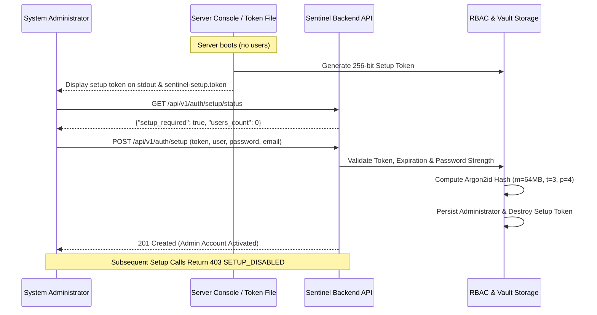

# Secure First-Run Initialization & Token Management
**Product:** CCTV SENTINEL UNIVERSAL  
**Module:** Enterprise Security Engine (`backend/pkg/security/rbac.go`)  
**Release:** Phase 6.1 Stabilization  
**Author:** Tech Defence Solutions  

---

## 1. Zero Default Credentials Policy

All hardcoded credentials (`admin`, `technician`, `auditor`, `viewer` with predictable passwords) have been permanently eradicated from the production codebase.

When the application boots with an empty user store:
1. It automatically enters **Setup Pending Mode** (`setupMode = true`).
2. A cryptographically random 256-bit setup token (`sent-setup-<64-hex>`) is generated using `crypto/rand`.
3. The token is written to disk at `./sentinel-setup.token` (or within `./data/`) with restricted permissions (`0600`) and logged to the server console.
4. The setup token has a mandatory 24-hour expiration window.
5. All protected endpoints reject access with HTTP 401 Unauthorized until the initial administrator is created.

---

## 2. Setup Lifecycle Workflow

---

## 3. Password Strength Enforcement

Initial and subsequent user accounts must satisfy enterprise complexity rules (`ValidatePasswordStrength`):
- Minimum length: **10 characters**
- At least one uppercase ASCII letter (`A-Z`)
- At least one lowercase ASCII letter (`a-z`)
- At least one numerical digit (`0-9`)
- At least one special symbol (`!@#$%^&*()-_=+[]{}|;:,.<>?/~\`\``)

---

## 4. Argon2id Key Derivation Configuration & DoS Protection

Password hashes are generated using **Argon2id** (RFC 9106 recommended parameters):
- **Memory Cost ($m$):** 64 MB (65,536 KiB)
- **Time Cost ($t$):** 3 iterations
- **Parallelism ($p$):** 4 threads
- **Salt Length:** 16 bytes cryptographic random salt
- **Key Length:** 32 bytes derived key

### Boundary Validation (Anti-DoS Defense)
To prevent maliciously configured Argon2 parameter payloads from starving server CPU and memory:
- Memory cost bounds: $16\,\text{MB} \le m \le 512\,\text{MB}$
- Iteration bounds: $1 \le t \le 10$
- Parallelism bounds: $1 \le p \le 16$
- Salt & key length: $16 \le \text{len} \le 64\,\text{bytes}$

### Concurrency Isolation
Argon2id computations are performed outside the global mutex write lock in `Authenticate()`. Multiple login requests do not serialize or block other concurrent API transactions.
