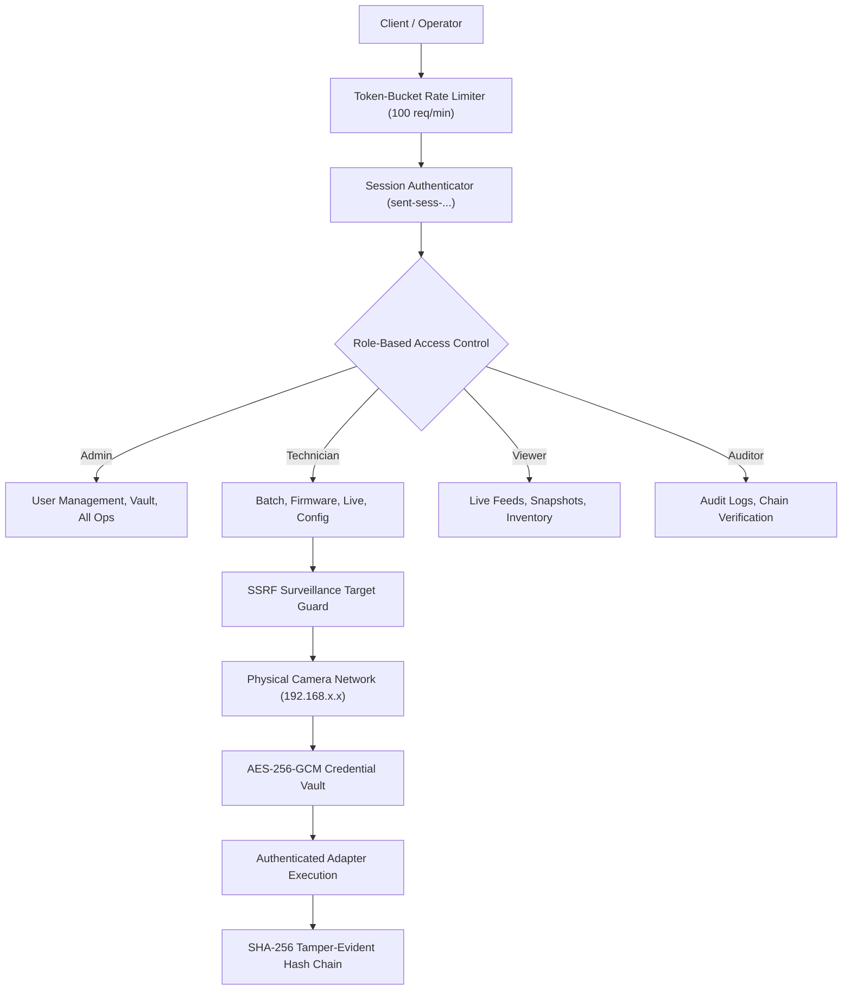

# CCTV SENTINEL UNIVERSAL — ENTERPRISE SECURITY ARCHITECTURE
## Cryptographic Vault, Role-Based Access Control & Defense-in-Depth

**Product:** CCTV SENTINEL UNIVERSAL  
**Company:** Tech Defence Solutions  
**Tagline:** ONE TOOL. EVERY CCTV. COMPLETE CONTROL.  

---

## 1. Security Architecture Principles

CCTV Sentinel Universal operates inside enterprise operational technology (OT) and security network enclaves. Cameras and recorders are prime targets for cyber adversaries (e.g. Mirai botnets, lateral movement pivots, and unauthorized surveillance monitoring).

The architecture adheres to four core security design principles:
1. **Zero Plaintext Secrets**: Passwords, digest nonces, API tokens, and RTSP authorization strings are never persisted in plaintext, written to disk unencrypted, or emitted into log files.
2. **Strict Least Privilege**: Operational capabilities are segregated into distinct cryptographic roles.
3. **Surveillance Target Isolation (SSRF Guard)**: Network clients cannot use the Sentinel server as an unauthorized proxy to probe cloud metadata, internal corporate systems, or loopback interfaces.
4. **Tamper-Evident Accountability**: Every system mutation generates an immutable, SHA-256 chained transaction entry.



---

## 2. Role-Based Access Control (RBAC)

The platform defines 4 standard enterprise security roles:

| Role | Permitted Capabilities | Restrictions |
|---|---|---|
| `ADMIN` | User account creation, vault management, licensing, system reboot, all device operations. | None |
| `TECHNICIAN` | Batch dispatch, firmware updates, device enrollment, network/image configuration, PTZ control. | Cannot create user accounts or access root vault keys. |
| `VIEWER` | Live video streaming grid, snapshot capture, device inventory inspection, calculator tools. | Cannot alter camera configurations, flash firmware, or reboot. |
| `AUDITOR` | View audit trail, export commissioning reports, execute cryptographic chain verification. | Cannot interact with live camera streams or modify device state. |

### Password & Session Token Cryptography:
- **Password Storage**: Passwords are salted with 16 cryptographically random bytes (`crypto/rand`) and hashed using SHA-256 with 10,000 iterative stretches (`SaltedSHA256`).
- **Session Tokens**: Generated with 24 random bytes, formatted as `sent-sess-<hex>`, and stored in memory with configurable 8-hour expiration TTL.

---

## 3. Credential Vault (AES-256-GCM)

Camera credentials (admin passwords, RTSP tokens) are protected using Authenticated Encryption with Associated Data (AEAD) via AES-256 in Galois/Counter Mode (GCM):
1. **Key Derivation**: 256-bit symmetric encryption key stored in OS-protected storage (`sentinel.vault.key`).
2. **Unique Nonce Per Ciphertext**: Every encrypted credential generates a fresh, non-repeating 12-byte random nonce from `crypto/rand`.
3. **Authentication Tag**: GCM appends a 16-byte authentication tag ensuring ciphertext integrity. Any byte-level modification or tampering causes `cipher.Open()` to immediately reject decryption with `cipher: message authentication failed`.
4. **Key Separation**: The vault encryption key is stored in a separate, access-restricted file location and is never serialized into database backups or audit reports.

---

## 4. Server-Side Request Forgery (SSRF) Guard

Because Sentinel allows technicians to specify IP addresses for discovery and stream diagnostics, attackers might attempt to use the server as a proxy to probe internal cloud environments or loopback services.

The `security.ValidateSurveillanceTarget(ip)` function enforces strict IP filtering:

```go
func ValidateSurveillanceTarget(targetIP string, allowLoopback bool) error {
    ip := net.ParseIP(strings.TrimSpace(targetIP))
    if ip == nil {
        return errors.New("invalid IP address format")
    }
    // Block Cloud Provider Instance Metadata Service (IMDS)
    if ip.Equal(net.ParseIP("169.254.169.254")) {
        return errors.New("SSRF BLOCKED: Probing cloud metadata endpoints is prohibited")
    }
    // Block IPv4 link-local (169.254.0.0/16)
    if ip.IsLinkLocalUnicast() {
        return errors.New("SSRF BLOCKED: Link-local addresses prohibited")
    }
    // Block Multicast as diagnostic target
    if ip.IsMulticast() {
        return errors.New("SSRF BLOCKED: Multicast addresses prohibited for direct connection")
    }
    // Block loopback unless development mode explicitly enabled
    if ip.IsLoopback() && !allowLoopback {
        return errors.New("SSRF BLOCKED: Loopback target prohibited")
    }
    return nil
}
```

---

## 5. Token-Bucket IP Rate Limiting

To protect the server against denial-of-service and credential brute-forcing, an in-memory token bucket rate limiter inspects every incoming HTTP request:
- **Rate Limit**: 100 requests per minute per client IP.
- **Burst Capacity**: 20 requests.
- **Response On Exhaustion**: Returns HTTP 429 Too Many Requests with header `Retry-After: 60`.
- **Automatic Eviction**: Inactive client IP buckets are pruned every 10 minutes to prevent memory leaks.

---

## 6. Command & Injection Prevention

- **Subprocess Safety**: All background tools and network diagnostics invoke commands via explicit argument slices (e.g. `exec.Command(binary, arg1, arg2)`). The platform **never** passes strings to `cmd.exe /c` or PowerShell subshells, eliminating shell command injection risks.
- **Path Sanitization**: Snapshot exports and firmware package uploads sanitize filenames through `filepath.Base()` and verify destination paths remain strictly within approved sandbox directories, eliminating path traversal attacks (`../`).
